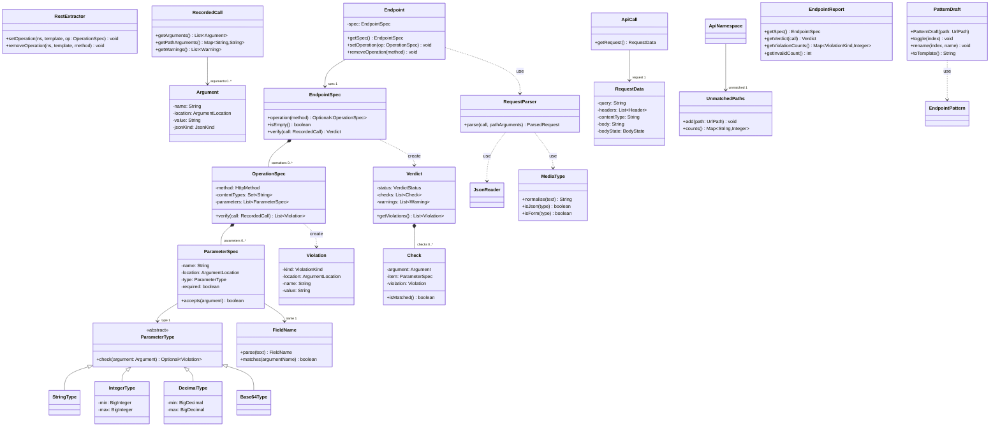

# US11 REST verification: design spec (draft 0.2)

> **Draft 0.6** (after review 4): **this plan only produces the design documents** (use case,
> domain model, class, system sequence and sequence diagrams, the formal specification, the test
> plan and the coverage document). No code is written. §0–§12 are the agreed design content the
> documents are made from; §13–§16 say which documents, what goes in each, and how they are checked.
>
> **Draft 0.5** (after review 3): D1 confirmed, so D1 to D16 are all settled.
> **Draft 0.4** (after review 2): all decisions settled. Spec generation from reports dropped (D11),
> generic repeated-parameter warning (D14), "nothing undeclared is checked" (§0.2), unmatched paths
> moved to their own per-namespace panel, secondary to verification (D4).

Builds on US10 as on `origin/us10/feat/call-filters` (all open MRs !26 to !32), class diagram v3
(`diagrams/US10 class diagram v3.puml`). Story: assignment p.22–23. Everything below assumes the
**recommended** option of each decision in §0; change a decision and the affected sections are named.

---

## 0. Decisions

| # | Decision | Status | Outcome | Affects |
|---|---|---|---|---|
| **D1** | What a spec belongs to | ✅ settled (review 3) | an **operation** = endpoint + method. Every operation may have path, query, header and body constraints (a POST can have query parameters). The method is data (`HttpMethod`), not a class per method | §4, §7, §8, GUI |
| **D2** | When calls are verified | ✅ settled | **when the report is made**, against the current spec; changing the spec makes `Endpoint` drop its verdict cache, so the next report re-judges every call | §8, §11 |
| **D3** | What is shown | ✅ settled | endpoint **without spec: no indicator at all** (plain black count, as US10). With a spec: tree shows **green count** (valid calls) and **red count** (invalid), not-verified calls (preflight) uncoloured. Detail view and documentation show **every checked value** with a green ✓ or a red ✗ and a diagnostic message naming the value and the spec item it breaks | §8, §10 |
| **D4** | Calls that match no pattern | ✅ settled, **secondary** | a separate **Unmatched paths panel per namespace** (distinct paths with their call counts, no per-call report) with **"Add endpoint pattern"**, which opens the **pattern builder**: the path as chips, a click toggles literal ↔ variable. Not in the tree, not in the documentation; built last (§10.4) | §4, §10.4 |
| **D5** | Headers | ✅ settled | only headers the developer added a constraint for are checked; a header is never "extra" | §5, §8 |
| **D6** | Names of body fields | ✅ settled | `user.id`; `items[].id` for array items; `scores{}.x` for **every key of a map** (a JSON object used as a dictionary); depth limit 10 | §5.3, §7 |
| **D7** | JSON strictness | ✅ settled | strict but explained: Integer/Decimal need a JSON number, Base64 a JSON string, String a JSON string/number/boolean; messages say what was expected and what came (`expected Integer (a JSON number), got the string "42"`) | §6, §8 |
| **D8** | Empty start, required | ✅ settled | a new namespace or endpoint pattern starts with an **empty spec** (nothing checked). The developer adds and removes spec items. Path variables are always present by construction (the pattern matched), so they are never "missing"; query/body/header items have a **Required** checkbox (default off) | §7, §8 |
| **D9** | Number grammar | ✅ settled, extended | text values (path, query, form, header) as before; JSON values follow the JSON number grammar and what common deserialisers can represent, see §6.1 | §6 |
| **D10** | Base64 | ✅ settled | **one implementation** accepting the standard and the URL-safe alphabet (not mixed), padding optional but correct when present, empty invalid, in every location; see §0.1 Q-c | §6 |
| **D11** | Spec from recorded calls | ✅ settled: **dropped** | the developer always writes the spec; no generation from reports | — |
| **D12** | Header values | ✅ settled | **shown in full**, no masking | §10, §12 |
| **D13** | Keeping specs | ✅ settled | session only | scope |
| **D14** | Repeated parameters | ✅ settled | every value is checked separately; a **repeated** query/form parameter gets one generic yellow **warning** (not a violation), see §0.1 Q-d | §8 |
| **D15** | CORS preflight | ✅ settled | not verified, shown as "preflight" | §8 |
| **D16** | Where the spec is edited | ✅ settled | new **Specification** tab; items are added with a **kind dropdown** (§10.2) | §10 |

### 0.1 Answers to the review questions

**Q-a. Classes per method (`GetMethod`, `PostMethod`)? Can a POST take query parameters?**
Yes, any method can have a query string, and `POST /posts?draft=true` with a JSON body is
common. Methods differ in *which* parameters they take, not in *how* they are checked: checking a
query parameter of a GET and of a POST is the same code. Subclasses per method would have no
behaviour of their own (the "speculative generality" / lazy class smell). So the method stays an
`HttpMethod` value, and an `OperationSpec` per method holds that method's items. The only method
rule we add: a body item on GET, HEAD or DELETE gets a hint in the GUI ("unusual: many servers
ignore a body here"), not a refusal.

**Q-b. Why "spec from recorded calls"? Do we generate specs, or check records against a spec?**
The core of the story is the second: the developer **defines** the spec and the tool **checks**
the recorded traffic against it ("define the valid parameters and their types, and start scanning
upcoming traffic for compliance"). **Decided: generation is dropped (D11).** R8 ("compliance
against an API report from the REST extraction tool") is met by the extraction report itself now
showing, per call and per value, whether it complies with the developer's spec.

**Q-c. Base64: URL-safe in the URL, standard in the body: one implementation?**
Yes. RFC 4648 differs only in two characters (`+/` standard, `-_` URL-safe) and padding is the
same, so `Base64Type` is one checker that accepts either alphabet (never mixed in one value). The
location matters only *before* the check: in a query or form value an unencoded `+` already
became a space when decoding, so standard Base64 in a URL must send `%2B` (the help page says so),
while URL-safe Base64 needs no escaping.

**Q-d. Repeated parameters: which value do browsers and servers use?**
Browsers send every value as written (`URLSearchParams` and HTML forms keep all). Which one counts
is decided by the **server framework**, and they disagree (this is called HTTP parameter
pollution): Java Servlet `getParameter`, Spring `@RequestParam String`, Flask `args.get` take the
**first**; PHP and Django `QueryDict.get` the **last**; Express (qs) and ASP.NET give **all**
(array / comma-joined). **Decided:** every value is checked separately against the spec, and a
repeated parameter gets one generic warning: "`tag` appears 2 times. Check which value your HTTP
server or framework uses." No framework names, no per-framework setting.

**Q-e. How is `RequestData` different from `ApiCall`?**
`ApiCall` is the whole call: method, URL, request, response and time. `RequestData` is only the
request half: query, headers, content type, body. Without it `ApiCall`'s constructor grows from
5 to 9 parameters (long parameter list smell) and request and response fields mix. It is an
"extract class" refactoring; `ApiCall.getRequest()` gives it. (A matching `ResponseData` would be
symmetric but is not needed for US11.)

### 0.2 Settled small points

- **Nothing undeclared is checked.** A method, content type, query, body or header that the
  developer did not declare anything about for that method is never judged. The only "extra"
  report (story example "extra arguments") is inside a location the developer *did* declare: once
  an operation has at least one query item, an undeclared query parameter is EXTRA_ARGUMENT;
  the same for body fields; headers are never extra (D5).
- **Unmatched paths** (D4): collected for every started namespace, also without a spec, but shown
  only in their own panel, opened per namespace; they don't affect verdicts, counts or the documentation.

---

## 1. Context

US10 records calls per endpoint pattern and shows path arguments, method counts, status, response
headers and body. US11 adds the request side and checks it against a spec the developer writes.

| # | Requirement | Source |
|---|---|---|
| R1 | Capture query parameters, request headers, request body (`text/json`, `application/json`, `application/x-www-form-urlencoded`) | clarification §2 |
| R2 | Show all of it in GUI and documentation | clarification §4 |
| R3 | Set a type per argument: String, Integer, Decimal, Base64 | clarification §3 |
| R4 | Integer/Decimal range | clarification §3 |
| R5 | Detect invalid requests, show them in the GUI | clarification §4 |
| R6 | Detect unspecified method, unspecified content type, extra arguments | examples |
| R7 | Define the valid parameters, then scan traffic for compliance | what is expected |
| R8 | Verify "against an API report from the REST extraction tool": the US10 report shows per call and per value whether it complies with the spec (no spec generation, D11) | user story |

**Out of scope:** response validation, OpenAPI import/export, saving specs (D13), ZAP alerts,
changing or blocking traffic (the listener stays observe-only, always returns true).

## 2. Glossary

- **Operation**: endpoint pattern + HTTP method, e.g. `POST /posts/[POST_ID]/comments` (D1).
- **Argument**: one named value in a request: `name`, `location` ∈ {PATH, QUERY, BODY, HEADER},
  `value` (text) and, for JSON, its `jsonKind` (STRING, NUMBER, BOOLEAN, NULL, OBJECT, ARRAY).
- **Spec item**: one rule the developer added: a Method, a Content type, or a parameter item (Path
  variable, Query parameter, Body field, Header) with name, type, optional range and Required.
- **Spec** of an endpoint: its spec items, grouped per method (operation). Starts empty (D8).
- **Violation**: one way a call deviates from the spec (red). **Warning**: worth knowing but not a
  deviation (yellow), e.g. a repeated parameter or a body cut at 64 KB.
- **Check**: the result for one value against one spec item: ✓ matched (green), ✗ violation (red),
  or unchecked (no colour). The detail view and documentation show every check (D3).
- **Verdict** of a call: VALID, INVALID (≥1 violation), NOT_VERIFIED (endpoint without spec, preflight).

## 3. Approach

1. **Capture**: `ApiCall` gets a `RequestData` (query, headers, content type, body). The listener
   fills it; it does **not** parse (adapter stays thin, ZAP's `getUrlParams()` loses duplicates and
   order and depends on the session).
2. **Parse** in the domain: `RequestParser` (Pure Fabrication, like `UrlPath`) gives the
   `Argument`s and parse notes. JSON via an own strict `JsonReader` so `1.0`, `1` and
   `123456789012345678901234567890` keep their exact text (json-lib in ZAP turns them into doubles).
   Parsed once, when the call is recorded.
3. **Types** by Polymorphism (like `PathSegment`): abstract `ParameterType.check(argument)`.
4. **Spec**: `Endpoint` holds an immutable `EndpointSpec` (map method → `OperationSpec`), replaced
   as a whole; the Swing thread writes it, proxy threads never block on it.
5. **Verify** when the report is made (D2): `EndpointSpec.verify(recordedCall) → Verdict`.
   Pure function, cached per call until the spec changes.
6. **Report**: `EndpointReport` carries the spec snapshot, a `Verdict` per call (with every
   check, valid ones too) and counts; `ApiReport` carries the unmatched paths (D4).
7. **GUI**: Specification tab, Request section and violations in the detail view, a verdict column
   and "only invalid" filter in the call table, deviations in the documentation.
8. **Unmatched path → pattern** (D4): `PatternDraft` turns an unmatched path into chips the
   developer toggles between literal and variable; the result goes through the existing
   `EndpointPattern` validation.

## 4. Domain model

New and changed classes in `org.zaproxy.addon.restextraction.model` (no ZAP or Swing imports).

| Class | Kind | Responsibility (GRASP) |
|---|---|---|
| `RequestData` | new, immutable | raw request: query (still encoded, `""` if none), headers in order, content type (`""` if none), body text (cut/marked like responses), `BodyState` (NONE, TEXT, CUT, BINARY) |
| `ApiCall` | changed | + `getRequest()`; old constructor kept (empty request) so US10 tests stay |
| `ArgumentLocation` | new enum | PATH, QUERY, BODY, HEADER |
| `JsonKind` | new enum | STRING, NUMBER, BOOLEAN, NULL, OBJECT, ARRAY |
| `Argument` | new, immutable | one name/location/value (+ jsonKind for BODY from JSON) |
| `RequestParser` | new, Pure Fabrication | query/form/JSON/header → `Argument`s + parse notes; never throws |
| `JsonReader` | new, package-private | strict RFC 8259 reader, emits leaves with exact number text, depth limit |
| `MediaType` | new, Pure Fabrication | normalise `Text/JSON; charset=UTF-8` → `text/json`; isJson, isForm |
| `ParameterType` + 4 | new, Polymorphism | the type rules (§6) |
| `ParameterSpec` | new, immutable | name, location, type, required; validates itself (§7) |
| `OperationSpec` | new, immutable, Expert | content types + parameters of one method; `verify` (§8) |
| `EndpointSpec` | new, immutable | method → `OperationSpec`; finds the operation or gives UNSPECIFIED_METHOD |
| `Violation`, `ViolationKind`, `Warning`, `Check`, `Verdict` | new, immutable | results; every checked value is a `Check` (matched or with its `Violation`), so the GUI can mark correct values too; message text built in the UI from kind + fields (i18n) |
| `FieldName` | new, immutable | parsed body/query name with `.`, `[]` and `{}` parts; `matches` an argument name (§5.3); Pure Fabrication |
| `UnmatchedPaths` | new | per namespace: distinct unmatched paths (after the base path) with call counts; at most 1000 distinct paths, then only the total grows |
| `PatternDraft` | new, mutable, used by the GUI only | the chips of one unmatched path; toggle literal/variable, rename a variable, build the template (§10.4) |
| `RecordedCall` | changed | arguments become `List<Argument>` (path first, then query, body, header); `getPathArguments()` keeps the US10 map for `CallTableModel` and `valuesSeen` |
| `Endpoint` | changed | holds `volatile EndpointSpec`; `record` also parses; `createReport` verifies (cached) |
| `EndpointReport` | changed | + spec snapshot, verdict per call, violation counts, invalid count |
| `ApiNamespace` / `ApiReport` | changed | `UnmatchedPaths` filled by `record` when no endpoint matched (D4); report carries a copy |
| `RestExtractor` | changed | + `setOperation`, `removeOperation`, `getUnmatchedPaths(ns)` (facade, only delegates) |

## 5. Capturing and parsing the request

### 5.1 Listener (`RestTrafficListener.toApiCall`)
- Query: `msg.getRequestHeader().getURI().getEscapedQuery()`, `""` when null. URL stays without query (US10 rule).
- Headers: `getRequestHeader().getHeaders()` in order, name as sent.
- Content type: request `Content-Type` header or `""`.
- Body: same rules as the response body (reuse `bodyOf`/`isBinary`, generalised to `HttpHeader`+`HttpBody`): empty → NONE; binary type → BINARY with mark; > 64 KB → CUT; else TEXT. Text uses ZAP's decoding with the header charset (UTF-8 when none).
- Any exception → logged, traffic passes (US10 rule).

### 5.2 Query and form (`application/x-www-form-urlencoded`) rules
| Input | Result |
|---|---|
| `a=1&b=2` | QUERY a=1, b=2 in order |
| `a=1&a=2` | two arguments `a`, both checked, warning REPEATED_PARAMETER (D14, §0.1 Q-d) |
| `a` (no `=`) | a = `""` (present, empty) |
| `a=` | a = `""` |
| `=1` | name `""` → always EXTRA_ARGUMENT |
| `a=1&&b=2`, leading/trailing `&` | empty pieces skipped |
| `a=1;b=2` | one argument `a` = `1;b=2` (only `&` separates) |
| `+` | space (form rule; **unlike paths**, where `+` stays) |
| `%2B` | `+` |
| `%zz`, `%2` | piece kept with raw text, note MALFORMED_ENCODING on that argument → INVALID_TYPE for non-String types |
| `%C3%A9` | `é` (UTF-8); invalid UTF-8 bytes → replacement char + note |
| `ids[]=1&ids[]=2` | name is literally `ids[]`, two arguments |
| `a=1#frag` | fragments never reach a proxy; nothing to do |
| > 200 arguments in one call | first 200 kept, note TOO_MANY_ARGUMENTS (call not VALID, only checked partly) |

### 5.3 JSON (`application/json`, `text/json`, `application/*+json`)
| Input | Arguments |
|---|---|
| `{"title":"Hi","userId":3}` | BODY title="Hi"(STRING), userId=3(NUMBER) |
| `{"user":{"id":3}}` | `user.id`=3 |
| `{"items":[{"id":1},{"id":2}]}` | `items[].id`=1, `items[].id`=2 |
| `{"tags":["a","b"]}` | `tags[]`="a", `tags[]`="b" |
| `{"scores":{"alice":3,"bob":5}}` | `scores.alice`=3, `scores.bob`=5; a spec item `scores{}` matches both (any key) |
| `{"m":{"a":{"x":1}}}` | `m.a.x`=1; spec item `m{}.x` matches it |
| `[{"id":1}]` (top-level array) | `[].id`=1 |
| `42` or `"x"` (top-level scalar) | one argument named `$` |
| `{}` / `{"items":[]}` | no leaf arguments; containers recorded as OBJECT/ARRAY arguments (`items`) so a parameter typed on them gives INVALID_TYPE |
| `{"a":null}` | `a` with kind NULL |
| `{"a":1,"a":2}` (duplicate key) | two arguments `a` |
| key containing `.`, `[`, `]` or `\` | escaped with `\` (`"a.b"` → `a\.b`) |
| `{"n":1.0}`, `{"n":1e3}`, `{"n":-0}` | number text kept exactly: `1.0`, `1e3`, `-0` |
| deeper than 10 levels | not descended further, note TOO_DEEP |
| invalid JSON (trailing comma, single quotes, `NaN`, unclosed) | no body arguments, violation MALFORMED_BODY, no extra/missing checks for BODY |
| JSON body cut at 64 KB | note BODY_NOT_CHECKED, no BODY checks |
| BOM at start | ignored |

**Spec names** (`FieldName`, D6): parts separated by `.`; `[]` = every item of an array; `{}` =
every key of an object (map). Examples: `user.id`, `items[].id`, `[].id`, `scores{}`,
`scores{}.x`, `matrix[][]`. A spec item matches an argument when every part matches, `{}` against
any one key. A concrete key wins over `{}` when both are declared (`scores.alice` is checked by
`scores.alice`, `scores.bob` by `scores{}`). In **form** bodies and queries names are literal
(`user.id` is just a name, as the server sees it).

### 5.4 Headers
- Names compared case-insensitively, shown as sent. Repeated header → each value an argument.
- Values are not split on commas. Only declared headers are checked (D5).
- Hop-by-hop and proxy headers are never "extra" (none is, D5).

### 5.5 Content type of the request
- Normalise: trim, lower-case, drop parameters (`; charset=...`). `text/json`, `application/json`, `application/*+json` parse as JSON; `application/x-www-form-urlencoded` as form; anything else is not parsed (only shown).
- Body empty (length 0) → treated as "no body", whatever the Content-Type says.
- Body present and no Content-Type → content type `""`, shown as "(none)".
- `multipart/form-data` → not parsed in US11 (note BODY_NOT_CHECKED); content-type check still applies.

## 6. Parameter types (exact rules)

Checks never trim. All scanners are hand-written (no backtracking regex, no ReDoS).

| Type | Valid | Invalid | Range | JSON (D7) |
|---|---|---|---|---|
| **String** | any text, also `""` | never (except JSON null/object/array) | none | STRING, NUMBER, BOOLEAN |
| **Integer** | `[+-]?[0-9]+`: `42`, `-7`, `+3`, `007`, 30-digit numbers (BigInteger) | `""`, `4.0`, `1e3`, `0x10`, ` 42`, `4 2`, `١٢` (non-ASCII digits) | inclusive, min/max optional, compared as BigInteger | NUMBER only, and its text must fit the grammar (`1.0` invalid) |
| **Decimal** | `[+-]?[0-9]+(\.[0-9]+)?([eE][+-]?[0-9]+)?`: `9.99`, `-0.5`, `3`, `1e3`, `1.5E-2` | `""`, `.5`, `5.`, `NaN`, `Infinity`, `1,5`, `0x1p3` | inclusive, BigDecimal `compareTo` (so `1.0` = `1.00`) | NUMBER only |
| **Base64** | `aGVsbG8=`, `aGVsbG8` (no padding), `a-_b` (URL-safe) | `""`, mixed alphabets (`+` with `-`), bad padding (`a===`, `=` in the middle), length mod 4 = 1, whitespace | none | STRING only |

Limits: a value over 10 000 characters is INVALID_TYPE for Integer/Decimal (no huge BigInteger
work); exponent magnitude > 9 999 is INVALID_TYPE for Decimal.

Base64 (D10, Q-c): one checker for both alphabets everywhere. In a **query/form** an unencoded `+`
arrives as a space, so `?img=ab+c` is invalid; the help page tells developers to send `%2B` or use
URL-safe Base64.

### 6.1 JSON numbers (D9, review point 7)

JSON's own grammar is `-?(0|[1-9][0-9]*)(\.[0-9]+)?([eE][+-]?[0-9]+)?`: no `+`, no leading zeros,
no `.5`, no `NaN`/`Infinity`. Anything else is not JSON, so `JsonReader` refuses the body
(MALFORMED_BODY), and our types only ever see valid JSON number text.

| JSON value | Integer | Decimal | Why |
|---|---|---|---|
| `42`, `-7`, `0` | ✓ | ✓ | |
| `-0` | ✓ (equals 0) | ✓ | |
| `1.0`, `1e3`, `1E+2` | ✗ "expected an integer, got `1.0`" | ✓ | Integer means written as a whole number; many deserialisers (Java `int`, Jackson `long`, Go `int`) refuse `1.0`/`1e3` |
| `9007199254740993` (> 2^53−1) | ✓ + **warning** PRECISION | ✓ + warning | JavaScript `Number` and JSON parsers that use doubles silently round it (I-JSON, RFC 7493 §2.2) |
| `1e400` | — | ✓ + **warning** PRECISION | overflows a double to Infinity in most parsers |
| `0.1`, `0.30000000000000004` | — | ✓ | range checks use the **exact written value** (BigDecimal), not the rounded double: max `0.3` makes `0.30000000000000004` out of range |
| `"42"` (string) | ✗ "expected Integer (a JSON number), got the string \"42\"" | ✗ | D7 strict, with a clear message |

Text values (path, query, form, header) keep the D9 grammar: `+3` and `007` are valid Integers
there (Java `Integer.parseInt`, JS `Number` and most frameworks accept them).

## 7. Defining a spec (rules for the developer's input)

| Rule | Behaviour |
|---|---|
| Start | a new namespace and a new endpoint pattern have an **empty spec**: nothing is checked, no indicator (D8, D3) |
| Spec item kinds (dropdown, §10.2) | **Method** (allowed method), **Content type**, **Path variable**, **Query parameter**, **Body field**, **Header**. Every item except Method belongs to one method (operation); adding an item for a method that has no Method item yet adds that Method item too |
| Method | from `HttpMethod` except OTHER; the same method twice is refused; removing a Method item removes its other items after a confirmation |
| Path variable | chosen from the template's `[NAME]`s (dropdown, no free text); always present when the pattern matched, so it has no Required box; only type and range |
| Parameter name | not empty, no leading/trailing spaces; unique per (method, location, name), header names case-insensitive; body field names parsed by `FieldName` (§5.3), a broken name (`a..b`, `a[`, `{}x`) is refused |
| Body field | checked when the body is JSON or form; if the operation has Content type items, at least one of them must be JSON or form, else the body field is refused with a message |
| Content type | `type/subtype` syntax, normalised (§5.5); duplicates refused; **no Content type items = the content type is not checked** (empty spec stays quiet, §8 step 4) |
| Range | only for Integer/Decimal; min and max parsed with the type's own grammar; min ≤ max (equal allowed); changing the type to String/Base64 drops the range after a confirmation |
| Required | checkbox for query, body and header items, default off (D8) |
| Removing an endpoint | removes its spec |
| Editing while extracting | allowed; with D2 every recorded call is re-judged at once |
| Every refusal | `IllegalArgumentException` with a message, shown in the panel's message area (US10 pattern) |

## 8. Verification

Algorithm for one recorded call of an endpoint (report time, D2):

1. Endpoint spec empty → NOT_VERIFIED, no indicator (D3).
2. `OPTIONS` with `Access-Control-Request-Method` header → NOT_VERIFIED, label "preflight" (D15).
3. No Method item for the call's method (incl. OTHER) → **UNSPECIFIED_METHOD** ("`PUT` is not
   in the spec; allowed: GET, POST"), stop.
4. Content type (only if the operation has Content type items): body present and its type not
   among them → **UNSPECIFIED_CONTENT_TYPE** ("`text/plain` is not allowed for POST; allowed:
   application/json"); body still parsed when JSON/form. Body malformed → **MALFORMED_BODY**,
   body checks skipped. Body cut/binary/multipart → warning BODY_NOT_CHECKED.
5. Each argument in request order, against the operation's items of the same location:
   - matching item → `type.check` → ✓ **matched** or ✗ **INVALID_TYPE** / **OUT_OF_RANGE**
     ("`POST_ID` = `abc`: expected Integer", "`_limit` = `500`: above the maximum 100");
   - no matching item, and the operation has **at least one item in that location** → ✗
     **EXTRA_ARGUMENT** (§0.2); otherwise unchecked (no colour). Headers are never extra (D5);
   - a JSON container on a scalar item → one INVALID_TYPE; its leaves are not reported as extra.
6. Each Required item without an argument → **MISSING_ARGUMENT** ("required body field `title`
   is missing").
7. Warnings: REPEATED_PARAMETER (Q-d), PRECISION (§6.1), BODY_NOT_CHECKED, TOO_MANY_ARGUMENTS,
   TOO_DEEP. They never make a call invalid.
8. Verdict = INVALID if any violation, else VALID.

Order: method, content type, arguments in request order, missing items in spec order.
The response status code plays no role (a 400 answer to an invalid request is still invalid).

**Unmatched paths** (D4): when no endpoint matched, `ApiNamespace.record` adds the path after the
base path to `UnmatchedPaths` (only while the namespace is started; also without any spec, §0.2).
They never influence verdicts, tree counts or the documentation.
Stored as distinct paths with counts, no per-call data; at most 1000 distinct paths. Adding a
pattern does not move old unmatched calls into it (they were never recorded); the path's count
stays until **Clear calls**.

## 9. (removed: spec from recorded calls, D11 dropped)

## 10. GUI

Colours: green = matched, red = violation, yellow = warning, default text colour = nothing to
say. Light and dark look-and-feel colours come from the existing `errorColour`/`hintColour`
helpers plus a green and a yellow added the same way. Colour is never the only signal: every
mark also has a symbol (✓ ✗ ⚠) for colour-blind users.

### 10.1 Tree (D3)
- Endpoint **without spec**: `/posts/[POST_ID] (12 calls)` in the normal colour, as in US10.
- Endpoint **with spec**: `/posts/[POST_ID]  ✓ 10  ✗ 2` with the valid count green and the invalid
  count red; not-verified calls (preflight) are only in the plain total.
- Namespace: the sums of its endpoints. Unmatched paths are **not** in the tree (D4, §10.4).

### 10.2 Specification tab (D16, D8)
- Enabled when an endpoint is selected; starts empty with a hint ("No spec: calls are not checked").
- **Add item** dropdown: Method, Content type, Path variable, Query parameter, Body field, Header.
  The form below the dropdown shows only what that kind needs:

  | Kind | Fields |
  |---|---|
  | Method | method (dropdown) |
  | Content type | method, media type (presets *JSON*, *Form*, free text) |
  | Path variable | method, variable (dropdown of the template's names), type, min, max |
  | Query parameter | method, name, type, min, max, Required |
  | Body field | method, name (with hint `user.id`, `items[].id`, `scores{}`), type, min, max, Required |
  | Header | method, name, type, min, max, Required |

  Min/Max only appear for Integer and Decimal.
- Below: the items as a table grouped by method (**Method | Kind | Name | Type | Range | Required**)
  with *Edit* and *Remove*. A refused input keeps the form open and shows the message (US10 pattern).
  Logic in a testable `SpecItemTableModel` + `SpecItemForm` model, Swing only displays.
- Hint for a body item on GET/HEAD/DELETE (Q-a).

### 10.3 Calls table and detail view (D3)
- Calls table: new column **Check**: `✓` (green), `✗ 2` (red), empty when not verified, `⚠` when
  only warnings; **Only invalid** checkbox next to the existing filters (`CallTableModel.matches`
  gets the flag). Count label: `3 of 12 calls · ✓ 1 · ✗ 2`.
- Detail view, top to bottom:
  1. *Request*: method and URL with the decoded query; headers in full (D12); body formatted
     like response bodies (Full body applies).
  2. *Checks*: one line per checked value, e.g. `✓ query _limit = 5  (Integer 1..100)`,
     `✗ path POST_ID = abc  expected Integer`, `✗ POST is not in the spec (allowed: GET)`,
     `⚠ query tag appears 2 times. Check which value your HTTP server or framework uses.`
     Unchecked values (nothing declared for them) are listed without mark.
  3. *Response* (US10).
  The detail view becomes a read-only styled text pane (escaped HTML, like the Documentation tab)
  so the marks can be coloured; text from traffic is always escaped.

### 10.4 Unmatched paths panel and the pattern builder (D4, secondary)
- Secondary feature, built after verification works (step 10). An **Unmatched paths…** button
  (and tree right-click item) on a selected namespace opens a separate panel for that namespace:
  a small table **Path | Calls** (no per-call report), *Clear*, and **Add endpoint pattern** for
  the selected path. The panel refreshes with the same 500 ms redraw.
- The button opens a dialog with the path after the base path as **chips**:
  `/ [api] / [42] / [comments]`. Each chip is a toggle:
  - **literal** (default): shows the decoded text, not editable;
  - **variable**: shows `[` editable name `]`, default name = the part's text cleaned to the
    allowed characters `A–Z a–z 0–9 _` (other characters become `_`; empty → `VAR`; a duplicate
    gets `_2`, `_3`).
- A live preview shows the template (`/api/[42]/comments`) and whether it is valid; *Add* calls the
  existing `RestExtractor.addEndpoint`, so every US10 rule applies (EP1–EP22). The new endpoint
  starts with an empty spec.
- Edge cases: a part that is empty (`//`) cannot be a chip, the path can't be turned into a
  pattern (message); a literal part containing `[`, `]` or `%` can only be made variable (US10 EP20);
  literal parts are percent-encoded again when building the template (`my doc` → `my%20doc`);
  the dialog uses `PatternDraft` (model), so it is unit-testable without Swing.

### 10.5 Documentation
- Per endpoint: the spec as a table per method (or "No spec"); counts `✓ 10 ✗ 2` and deviations per
  kind; per call its arguments with the same ✓/✗/⚠ marks and messages as the detail view.
- All strings in `Messages.properties`; help page and README updated.

## 11. Concurrency and performance

- Specs are immutable; `Endpoint.spec` is a `volatile` reference replaced as a whole; readers take
  one snapshot per report, so a report never mixes two specs.
- Verdict cache in `Endpoint`: identity map `RecordedCall → Verdict` plus the spec it was made
  with; a new spec clears it. Keeps the 500 ms redraw cheap at 1000+ calls (existing test M6).
- Parsing happens on the proxy thread, once per recorded call, bounded by §5 limits.
- Memory: request body ≤ 64 KB per call, as for responses (documented).

## 12. Security

- Every value from traffic escaped in HTML (existing `escape`) and shown as plain text in the detail view.
- Header values are shown in full (D12); the help page warns that tokens and cookies are visible in
  the panel, as they already are in ZAP's own History tab.
- No regex on traffic data; depth (10), argument count (200), value length (10 000) and body size (64 KB) limits.
- The listener never throws and never changes traffic.

## 13. Deliverables (design documents only)

All in a new workspace folder **`design/us11/`** (outside the three Git repositories, like
`diagrams/`; copying them into `Submissions` or GitLab is a later, separate step). Diagrams are
PlantUML sources rendered to PNG and SVG (`plantuml`, already installed); the domain model and the
class diagram also get an editable `.drawio` through `diagrams/puml2drawio.py` (draw.io can import
the other diagrams' PlantUML as an image). Documents are Markdown.

| # | File | What |
|---|---|---|
| 1 | `README.md` | index: every document, its version, how to render, which decision/rule IDs it uses |
| 2 | `US11 specification.md` | the **formal specification**: short, normative, every decision and rule numbered |
| 3 | `US11 domain model.puml` (+ `.png`, `.svg`, `.drawio`) | concepts, attributes, associations; no methods |
| 4 | `US11 use case diagram.puml` (+ `.png`, `.svg`) and `US11 use cases.md` | diagram + use case texts |
| 5 | `US11 system sequence diagrams.puml` (+ renders) | one SSD per main use case |
| 6 | `US11 class diagram.puml` (+ `.png`, `.svg`, `.drawio`, `.layout.json`) | **changes only** on top of US10 v3 |
| 7 | `US11 sequence diagrams.puml` (+ renders) | SD-V1 to SD-V5, one `@startuml` block (page) each |
| 8 | `US11 test plan.md` | unit, integration, end-to-end and manual tests with IDs, inputs, expected results, rule references |
| 9 | `US11 coverage.md` | coverage goals, how they are measured, requirement and rule traceability |

**Reuse for the documents:**
- `diagrams/US10 class diagram v3.puml`: the base the US11 class diagram extends (same styles,
  frames, member notation); the US10 classes that US11 touches are copied from it.
- `diagrams/puml2drawio.py` and the layout-JSON approach: `.drawio` for domain model and class diagram.
- `.local/diagram-check/compare_with_code.py`, `verify_text.py`, `edges2.py`: base for the §16 checks.
- US10 documents in `~/Downloads` (`US10 use case diagram.pdf`, `US10 domain model.pdf`,
  `US10 sequence diagrams v2.pdf`, `US10 test plan.pdf`): structure, notation and ID style
  (EP, NS, SC, M…) to stay consistent with what the supervisor already saw.
- Existing US10 test helpers named in the test plan (`ScenarioSession`, `call(...)`, `message(...)`).

## 14. Content of each document

### 14.1 Formal specification (`US11 specification.md`)
Short and normative ("must"), no rationale beyond one line; the plan keeps the reasoning.
1. Scope and terms (glossary of §2, R1–R8 of §1, out of scope).
2. Decisions **D1–D16** as one table: decision and outcome only.
3. Numbered rules, each with an ID used by the test plan:
   - **SPEC-C**xx capture (§5.1, §5.5), **SPEC-Q**xx query/form (§5.2), **SPEC-J**xx JSON and field
     names (§5.3), **SPEC-H**xx headers (§5.4);
   - **SPEC-T**xx types and ranges (§6, §6.1);
   - **SPEC-S**xx defining a spec (§7, §0.2);
   - **SPEC-V**xx verification algorithm, order, warnings, message templates (§8);
   - **SPEC-U**xx unmatched paths and pattern builder (§8, §10.4);
   - **SPEC-G**xx GUI behaviour (§10), **SPEC-L**xx limits, threading, security (§11, §12).
4. A message catalogue: every violation and warning kind with its message template and example.

### 14.2 Domain model
Concepts only (Larman style, no software classes, no methods): API namespace, Endpoint pattern,
Operation, Spec item (Method, Content type, Parameter item with location, name, type, range,
required), Parameter type, Range, Call, Request, Response, Argument, Check, Violation, Warning,
Verdict, Unmatched path. US10 concepts that don't change are drawn plain; new ones highlighted.

### 14.3 Use cases
Actors: **Developer**; **Client application** (sends requests through the ZAP proxy); ZAP proxy as
the system boundary's input. Use cases:

| UC | Name | Level | Text |
|---|---|---|---|
| UC-V1 | Define the spec of an endpoint (add, edit, remove spec items) | user goal | **fully dressed** |
| UC-V2 | Verify traffic against the spec | user goal (system-driven while extracting) | **fully dressed** |
| UC-V3 | Inspect the verification result of a call (tree counts, Check column, detail view) | user goal | brief |
| UC-V4 | Read the compliance documentation | user goal | brief |
| UC-V5 | Add an endpoint pattern from an unmatched path (secondary) | user goal | brief |

US10 use cases (add namespace/endpoint, start/stop, view report) appear as context, linked with
«include»/«extend» only where needed. Fully dressed texts: primary actor, stakeholders and
interests, preconditions, success guarantee, main success scenario, extensions (every refusal of
§7 and every verdict outcome of §8), special requirements (limits, threading), technology list.

### 14.4 System sequence diagrams
SSD-V1 for UC-V1 (developer ↔ system: `addSpecItem`, `editSpecItem`, `removeSpecItem` and the
refusal alternative), SSD-V2 for UC-V2 (client app → system request/response through the proxy,
developer reads verdicts), each with the system operations listed (operation contracts for
`addSpecItem` and `recordCall` in the use case document).

### 14.5 Class diagram (changes only)
New classes of §4 with all members; changed US10 classes with only their new or changed members
(stereotype «changed»); unchanged US10 neighbours as name-only boxes; same layers and frames as
v3; notes with the key pseudocode (verify algorithm, field-name matching, cache invalidation),
GRASP role per class. Layout file so the `.drawio` keeps a fixed, readable layout.

### 14.6 Sequence diagrams
| SD | Shows | From → to |
|---|---|---|
| SD-V1 | Recording a call with its request (capture, parse once) | `RestTrafficListener` → `RequestData` / `ApiCall` → `RestExtractor` → `ApiNamespace` → `Endpoint` → `RequestParser` (→ `JsonReader`, `MediaType`) → `RecordedCall`; unmatched branch → `UnmatchedPaths` |
| SD-V2 | Adding a spec item | `SpecificationPanel` → `SpecItemForm` → `RestExtractor.setOperation` → `Endpoint` (new immutable `EndpointSpec`, verdict cache cleared); refusal alternative |
| SD-V3 | Making the report and verifying | panel redraw → `RestExtractor.getReport` → `Endpoint.createReport` → `EndpointSpec.verify` → `OperationSpec` → `FieldName.matches` / `ParameterType.check` (polymorphic) → `Check` / `Violation` / `Warning` → `Verdict` → `EndpointReport` |
| SD-V4 | Showing a call's checks | `onSelectCall` → `EndpointReport.getVerdict` → `CheckWriter` → detail view; tree labels from the counts |
| SD-V5 | Pattern from an unmatched path (secondary) | `UnmatchedPathsPanel` → `PatternDraft` (toggle, rename, `toTemplate`) → `RestExtractor.addEndpoint` |

Same conventions as the US10 SDs: returns drawn where used, notes for the rules, `alt`/`loop`/`opt`.

### 14.7 Test plan (`US11 test plan.md`)
Same conventions as the US10 test plan (class names `*UnitTest` / `*ScenarioTest`, Given/When/Then,
Hamcrest, IDs, a "Source" column pointing to a SPEC rule or decision). Four levels:

| Level | What it means here | Groups (each a table of cases) |
|---|---|---|
| **Unit** | one class, collaborators simple or mocked | MT `MediaType`, JR `JsonReader`, RP `RequestParser`, FN `FieldName`, PT-S/PT-I/PT-D/PT-B the four types, PS `ParameterSpec`, OS `OperationSpec`, ES `EndpointSpec`, VD `Verdict`/`Check`, UM `UnmatchedPaths`, PD `PatternDraft`, RD `RequestData`/`ApiCall`, SM `SpecItemForm`/`SpecItemTableModel`, CT `CallTableModel`, CW `CheckWriter`, WR `ApiDocumentationWriter` |
| **Integration** | several real domain classes, no GUI, no ZAP proxy | TL listener → `ApiCall`/`RequestData` from real `HttpMessage`s; EI `Endpoint` + `RequestParser` + spec + cache; RX `RestExtractor` facade; CC concurrency (8 threads record while the spec is replaced; no lost call, no mixed spec in a report) |
| **End-to-end** | a whole session from proxy listener to report, writer and panel, with hand-made messages (Q14 of US10: counts as scenario test) | SC-V1…SC-V10 below, PN-E panel driven with a real extractor: add spec items, see counts/colours/filter |
| **Manual** | real ZAP + Firefox profile + jsonplaceholder / Juice Shop | M-V1…M-V7 with steps, expected result and a screenshot name |

End-to-end scenarios: SC-V1 story example `POST /posts/[POST_ID]/comments` with JSON body and
typed items, valid → ✓; SC-V2 wrong type + out of range + extra argument → three violations;
SC-V3 unspecified method and content type; SC-V4 spec edited afterwards re-judges old calls;
SC-V5 empty spec: nothing marked; SC-V6 preflight; SC-V7 unmatched path → pattern from the
builder → later calls recorded under it; SC-V8 repeated parameter warning; SC-V9 nested JSON with
`items[].id` and `scores{}`; SC-V10 partial spec: undeclared things never judged, extra only
inside a declared location.

Manual: M-V1 spec items of each kind in the GUI; M-V2 invalid call red with ✗ diagnostics and
valid values green ✓; M-V3 tree counts green/red/plain; M-V4 Unmatched paths panel → pattern
builder; M-V5 documentation; M-V6 1000-call burst stays responsive; M-V7 dark look-and-feel.

Plus: test data (the request samples of §5.2/§5.3/§6 as a shared list), and a counted
summary per level for the sign-off card.

### 14.8 Coverage document (`US11 coverage.md`)
- Goals: line ≥ 90 % and branch ≥ 85 % for `model`; ≥ 80 % for `ui` models and writers; Swing
  layout code measured but without a goal (covered by PN-E and manual tests), with the reason.
- How: `./gradlew :addOns:restextraction:test jacocoTestReport`, where the report is, how to read it;
  US10 baseline numbers measured when the document is written.
- Traceability matrix: R1–R8 → use case → SPEC rules → test IDs; and a reverse check that every
  SPEC rule has at least one test and every test cites a rule or decision.
- Per class: expected tests and the uncovered branches we accept (e.g. defensive `catch` in the
  listener), with the reason.

## 15. Steps

- [x] 1. Create `design/us11/` and `README.md` (index, conventions, how to render)
- [x] 2. Write `US11 specification.md` from §0–§12 (rules SPEC-… and the message catalogue)
- [x] 3. Domain model `.puml` → PNG/SVG/`.drawio`
- [x] 4. Use case diagram `.puml` + `US11 use cases.md` (UC-V1, UC-V2 fully dressed; operation contracts)
- [x] 5. System sequence diagrams SSD-V1, SSD-V2
- [x] 6. Class diagram (changes only) `.puml` + layout → PNG/SVG/`.drawio`
- [x] 7. Sequence diagrams SD-V1…SD-V5
- [x] 8. `US11 test plan.md` (unit, integration, end-to-end, manual)
- [x] 9. `US11 coverage.md` (goals, method, traceability, US10 baseline)
- [x] 10. Consistency checks of §16, fix what they find, update the README versions

## 16. Verification (of the documents)

- Every `.puml` renders without PlantUML errors (PNG and SVG), every `.drawio` passes `xmllint`.
- Script checks (extending `.local/diagram-check/`):
  - every class and message in the sequence diagrams exists in the class diagram (or in US10 v3),
    with the same parameter count;
  - every class in the class diagram appears in the domain model (as concept) or is a Pure
    Fabrication/UI class marked as such;
  - every SPEC rule ID is cited by at least one test case, and every test case cites an existing
    rule or decision;
  - R1–R8 each reach at least one use case, rule and test.
- Read-through against §0: each decision D1–D16 appears in the specification with the same outcome.
- Team review (Mathias for the diagrams), then the documents are copied where the team wants them.

## 20. Decisions log

All 16 decisions are settled in §0; the specification document (§14.1) is where they are kept from now on.
